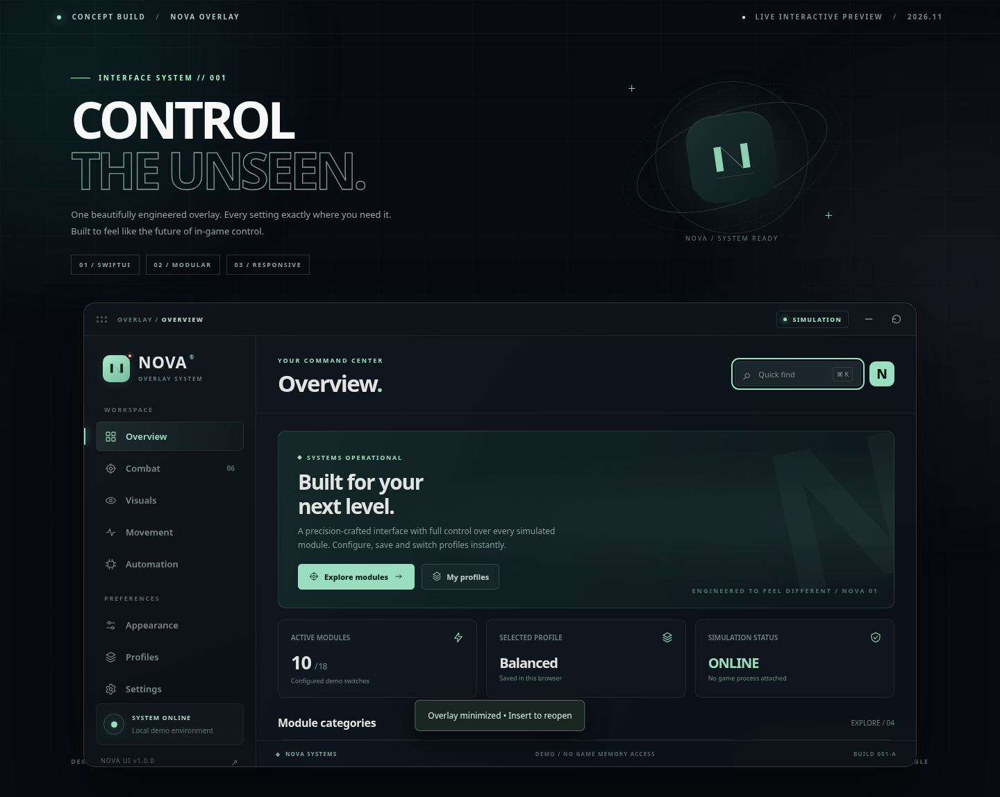
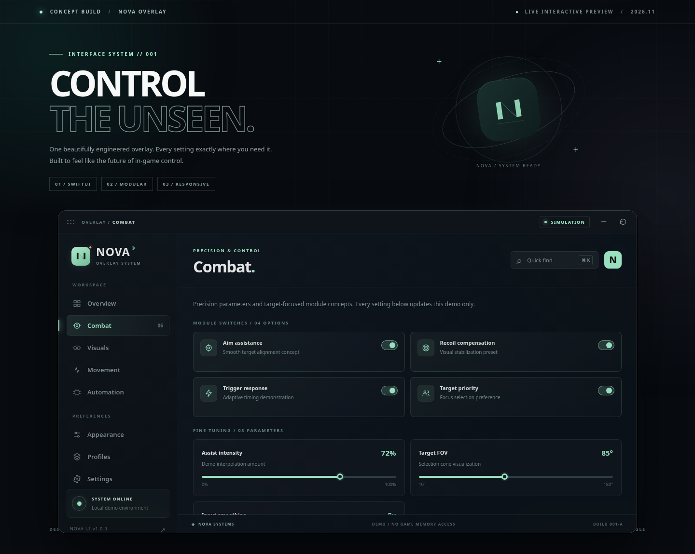
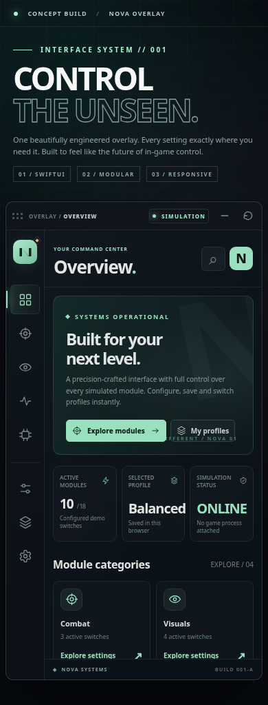

<div align="center">

# ◈ NOVA — iOS Game Overlay

**A thoughtfully crafted, interactive gaming control-panel concept.**  
SwiftUI reference implementation · Responsive web showcase · 25 configurable UI functions · 8 destinations



[**Interactive showcase**](https://bee171204.github.io/nova-ios-mod-menu/) · [**Native SwiftUI source**](ios/NOVAOverlay/NOVAOverlay.swift) · [**How to integrate**](docs/INTEGRATION.md) · [**QA results**](docs/QA_REPORT.md)

</div>

> [!IMPORTANT]
> **Interface/demo project only.** The switches, sliders and settings change **local demonstration state**. They do not access, modify or inject code into a game, modify an IPA binary or bypass protections. The SwiftUI component can be integrated into iOS applications for which you own the source code or have authorization. No prebuilt modded IPA is included.

## Preview gallery

| Modules and controls | iPhone-sized responsive preview |
|---|---|
|  |  |

The screenshots are captures of the rendered, interactive browser UI—not AI concept art.

## What is included

- **Overview:** status dashboard, active module count, configurable-category shortcuts, radar preview.
- **Combat:** aim-assistance UI, recoil stabilization, trigger response, target priority, strength/FOV/smoothing sliders.
- **Visuals:** bounding boxes, skeleton, tracers, name tags, mini radar, highlight layers, render range.
- **Movement:** sprint, strafe, jump timing, free camera, speed/camera FOV sliders.
- **Automation:** auto-loot queue, healing, quick swap, auto ping and action delay.
- **Appearance:** five live accent palettes, opacity/scale sliders, animation, ambient-glow and compact-layout toggles.
- **Profiles:** Balanced, Cinematic, Performance and Creator; save locally, export and import validated JSON.
- **Settings:** master switch, reset-to-default, version/environment information.

The web overlay can be dragged by its top bar, minimized to a floating launcher and restored using `Insert`. `Ctrl+K`/`⌘K` opens quick search. Configuration persists in browser localStorage; no account or network backend is required.

## Run locally

**Prerequisite:** Node.js 20 or newer.

```bash
npm install
npm test
npm run dev
```

Open the local URL printed by Vite. The production build is `npm run build` and publishes into `dist/`.

The repository has a [GitHub Pages workflow](.github/workflows/pages.yml). If the live link is not yet active, enable **Settings → Pages → Build and deployment → GitHub Actions** for this repository.

## iOS / SwiftUI

Native example sources are in [`ios/`](ios/). They include an interactive floating panel, eight categories, on-device preference persistence, a draggable header and a minimizable launcher. On a Mac with Xcode/XcodeGen:

```sh
cd ios
xcodegen generate
open NOVADemo.xcodeproj
```

Select an iOS simulator and run the `NOVADemo` scheme. **Native iOS compilation and simulator testing have not been performed here**; this is an example target requiring macOS/Xcode. See [integration notes](docs/INTEGRATION.md) for the supported source-level approach and restrictions.

## Architecture

```text
nova-ios-mod-menu/
├── index.html                   Browser demo shell
├── src/
│   ├── app.js                   Navigation, interaction and local state
│   ├── data.js                  Feature registry, presets, validation
│   └── styles.css               Responsive NOVA design system
├── ios/
│   ├── NOVAOverlay/NOVAOverlay.swift  SwiftUI overlay component
│   ├── Example/NOVADemoApp.swift    Native demo host app
│   └── project.yml              XcodeGen configuration
├── assets/screenshots/          Real browser screenshots
├── docs/                        QA and source-level integration
├── tests/                       Node catalog/validation tests
└── .github/workflows/pages.yml  Optional Pages deployment
```

## Responsible usage

This project does not implement real cheat features, runtime injection, signing bypass, account authorization bypass, anti-detection or credential retrieval. Naming a control after a typical game overlay feature is a UI design decision only. Use extensions and integration mechanisms that are authorized by the application owner and game publisher.

**License:** MIT. Original NOVA UI concept; no third-party game images or player accounts are included.
